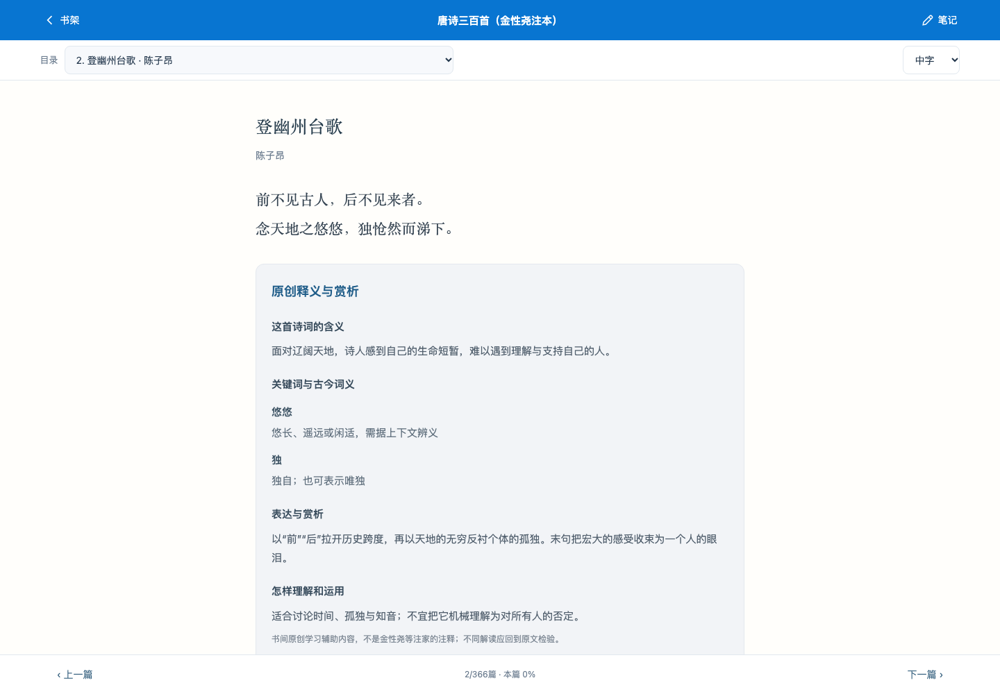

# Books · A Personal Reading Collection

A reading collection for exploring poetry, history, ideas, literature, and the English-speaking world—one book at a time.

The collection brings together **68 titles and box sets across 8 categories**: Tang poetry and Song lyrics; modern poetry and essays; Chinese and world history; comparative historical timelines; society and philosophy; Chinese literature; and English classics.

Highlights include *Three Hundred Tang Poems*, *Remarks on Ci Poetry*, *Sapiens*, *Guns, Germs, and Steel*, *To Live*, *The Three-Body Problem*, *Aesop’s Fables*, *Alice’s Adventures in Wonderland*, and *The Secret Garden*. Original-language titles, authors, translators, and selected editions are listed below.

## Explore the Reading Lists

### Classical Chinese Poetry & Song Lyrics · 12 selections

- **唐诗三百首（金性尧注本）** — 蘅塘退士 编 / 金性尧 注
- **唐诗鉴赏辞典** — 上海辞书出版社 编
- **宋词三百首** — 上彊村民 编
- **宋诗选注** — 钱钟书 选注
- **唐宋词十七讲** — 叶嘉莹
- **叶嘉莹说杜甫诗** — 叶嘉莹
- **蒋勋说唐诗** — 蒋勋
- **长安客** — 北溟鱼
- **戴老师魔性诗词课** — 戴建业
- **人间词话** — 王国维
- **苏东坡传** — 林语堂
- **诗经（简体原文）** — 佚名

### Modern Poetry & Essays · 13 selections

- **野草** — 鲁迅
- **湘行散记** — 沈从文
- **人间草木** — 汪曾祺
- **云雀叫了一整天** — 木心
- **海子的诗** — 海子
- **北岛诗选** — 北岛
- **守夜人：余光中诗选** — 余光中
- **飞鸟集·新月集** — [印]泰戈尔 / 郑振铎 译
- **给青年诗人的信** — [奥]里尔克 / 冯至 译
- **万物静默如谜** — [波]辛波斯卡 / 陈黎 译
- **二十首情诗和一首绝望的歌** — [智]聂鲁达 / 李宗荣 译
- **当你老了：叶芝诗选** — [爱]叶芝 / 袁可嘉 译
- **二十亿光年的孤独** — [日]谷川俊太郎 / 田原 译

### Chinese History · 13 selections

- **中国历代政治得失** — 钱穆
- **万历十五年** — 黄仁宇
- **显微镜下的大明** — 马伯庸
- **大明王朝的七张面孔** — 张宏杰
- **讲谈社·中国的历史（全10卷）** — 宫本一夫 等
- **秦制两千年** — 张明扬
- **康熙的红票** — 孙立天
- **秦汉史讲义** — 秦晖
- **大明最后的使臣** — 苗子兮
- **翦商** — 李硕
- **食南之徒** — 马伯庸
- **长安的荔枝** — 马伯庸
- **明朝那些事儿** — 当年明月

### World History · 7 selections

- **极简欧洲史** — 约翰·赫斯特
- **人类简史** — 尤瓦尔·赫拉利
- **枪炮、病菌与钢铁** — 贾雷德·戴蒙德
- **丝绸之路** — 彼得·弗兰科潘
- **全球通史** — 斯塔夫里阿诺斯
- **文明的故事（全11卷）** — 威尔·杜兰特
- **罗马人的故事（全15卷）** — 盐野七生

### Connecting Chinese & World History · 5 selections

- **中外历史年表** — 翦伯赞 主编
- **DK时间线上的全球史** — 英国DK公司
- **万古江河** — 许倬云
- **历史大脉络** — 许倬云
- **枢纽：3000年的中国** — 施展

### Society, Philosophy & Personal Growth · 6 selections

- **世界作为参考答案** — 刘擎、严飞
- **哲学家的最后一课** — 朱锐
- **认知觉醒** — 周岭
- **论语（简体原文）** — 孔子弟子及再传弟子 编
- **大学（简体原文）** — 传统归于曾子及其传承，作者存在争议
- **孟子（简体原文）** — 孟子及其弟子 编

### Life & Literature · 6 selections

- **蛤蟆先生去看心理医生** — [英]罗伯特·戴博德
- **我与地坛** — 史铁生
- **希腊别传** — 陈嘉映
- **活着** — 余华
- **平凡的世界** — 路遥
- **三体** — 刘慈欣

### English Classics for Reading & Listening · 6 selections

- **The Tale of Peter Rabbit（彼得兔的故事）** — Beatrix Potter
- **Aesop’s Fables（伊索寓言）** — Aesop / V. S. Vernon Jones 译
- **The Wonderful Wizard of Oz（绿野仙踪）** — L. Frank Baum
- **Alice’s Adventures in Wonderland（爱丽丝梦游仙境）** — Lewis Carroll
- **The Happy Prince and Other Tales（快乐王子及其他故事）** — Oscar Wilde
- **The Secret Garden（秘密花园）** — Frances Hodgson Burnett

## Available to Read Now

**12 selections currently include readable text:**

- **Chinese originals:** the classical-text collections of *Three Hundred Tang Poems* and *Three Hundred Song Lyrics*, plus *The Book of Songs*, *The Analects*, *The Great Learning*, and *Mencius*.
- **English originals:** *The Tale of Peter Rabbit*, *Aesop’s Fables*, *The Wonderful Wizard of Oz*, *Alice’s Adventures in Wonderland*, *The Happy Prince and Other Tales*, and *The Secret Garden*.

Readable selections appear first **within their own category**. The remaining 56 entries are reading-list selections with introductions and links to search for authorized editions; their full text is not hosted here. Classical originals do not include the modern annotations or translations of the selected print editions.

## A Place to Read and Reflect

Keep your place across reading sessions, write reflections alongside each book, and explore English classics with adjustable-speed synthesized narration and retelling prompts. The collection also includes simplified Chinese poetry and vocabulary notes, with original commentary on selected poems.

Weekly additions expand the collection without automatically removing existing selections.

Reading and mobile previews

[Text sources and editions](READING_SOURCES.md) · [How to use the app](docs/SETUP.md)
