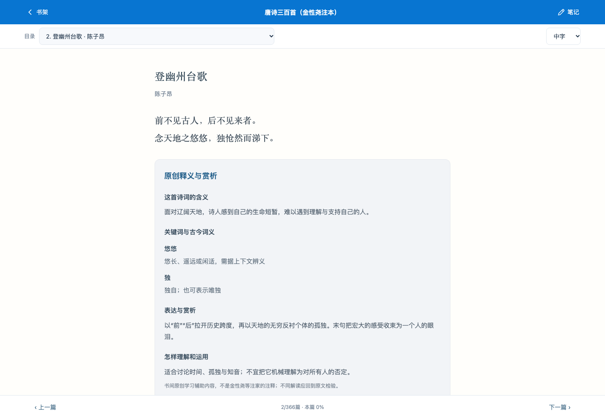

<div align="center">

# 书间 · Books

**把好书，读进生活里。**

一个适配电脑与手机的个人阅读书房：分类收藏、直接阅读、自动续读、读后感，以及英文听读练习。


[快速开始](#快速开始) · [功能](#功能) · [当前书库](#当前书库) · [书源与许可](../READING_SOURCES.md)

</div>


## 功能

- **按分类整理**：诗词、文学、历史、思想与英文阅读共 8 个板块。可直接阅读的书排在各自分类列表前面；支持搜索和状态筛选。
- **原文阅读与续读**：按书籍、篇章、段落和相对位置记住进度；调整字号后仍可定位同一段落。
- **读后感随书保存**：在书籍详情或阅读器内记录想法，自动保存，也可手动保存。书卡可直接删除书籍。
- **英文听读**：6 本英文原版支持浏览器合成朗读、语速调整、点击段落听读及复述练习提示。
- **简体诗词与学习辅助**：646 篇唐诗宋词原文统一简体，附关键词词义与阅读提示；42 篇有原创简要释义赏析。
- **本地持久保存**：Python 标准库服务配合 SQLite 保存个人数据；提供完整 JSON 备份与恢复。
- **每周仅新增**：GitHub Actions 每周从候选书单添加一项，保留已有书籍及用户删除标记。

<details>
<summary>查看阅读器与手机界面</summary>

### 站内阅读器



### 手机书架


</details>

## 当前书库

| 内容 | 数量 | 状态 |
| --- | ---: | --- |
| 书单条目 | 68 | 原始 58 项，加 6 本英文原版和 4 部公版原典 |
| 可直接阅读 | 12 | 已内置正文，可保存站内进度 |
| 尚未接入全文 | 56 | 保留书单、简介和正版平台查找入口 |
| 分类板块 | 8 | 可直接阅读的条目在各分类中优先展示 |

**中文原文 6 部：**《唐诗三百首》古诗原文库、《宋词三百首》古词原文库、《诗经》《论语》《大学》《孟子》。

**英文原版 6 本：**The Tale of Peter Rabbit、Aesop’s Fables、The Wonderful Wizard of Oz、Alice’s Adventures in Wonderland、The Happy Prince and Other Tales、The Secret Garden。

> “可直接阅读”指已内置的原典/英文版本。《唐诗三百首》不含金性尧注释，其他古典原文不含现代出版社译注。604 篇诗词内容为辅助导读，尚非完整逐句白话译文。英语难度为编辑建议，合成语音不是真人有声书。站外书籍的阅读权限和进度由相应平台处理。

## 快速开始

需要 Python 3.9 或更新版本，无需安装第三方运行依赖。

```sh
git clone https://github.com/yiyiyi1995/books_list.git
cd books_list
python3 server.py
```

然后打开 **http://127.0.0.1:8765**。macOS 也可双击 `start.command` 启动。

这是本地应用，GitHub 项目页不是在线阅读服务。服务需保持运行；当前未部署公网版本。

### 在手机上使用

手机与电脑连接同一可信 Wi-Fi，在电脑启动：

```sh
python3 server.py --host 0.0.0.0
```

按提示设置至少 8 位访问密码，手机访问 `http://电脑局域网IP:8765`。电脑与手机通过同一服务使用同一份数据；不要将此 HTTP 服务直接暴露到公网。

### 保存与备份

- 数据库位于 `data/books.sqlite3`，重启服务后仍会保留。
- 数据目录已加入 `.gitignore`，私人读后感与之前保存的正文不会提交到仓库。
- 页脚可导出或恢复完整 JSON 备份，建议异地保留副本。
- 直接打开 `index.html` 也可使用浏览器 IndexedDB，但该模式仅此浏览器保存，清理浏览器数据会丢失记录。
- 多设备同时修改时，后提交者会收到冲突提示；先导出未保存内容，再刷新合并。当前不提供多人协作或跨公网云同步。

## 每周书单更新

[每周新增工作流](../.github/workflows/weekly-books.yml) 计划在**每周一北京时间 09:00**运行，GitHub 实际执行时间可能延迟。

- 从 `candidates.json` 选取一项尚未加入的候选书，写入 `catalog.json` 并更新 `catalog.js`。
- 只追加，不自动删除或覆盖已有书籍。应用也会保留用户主动移出的书籍标记。
- 应用在距上次检查超过一周时，打开后静默检查远程书单。
- 初始候选池 12 项，用完后保持原书单并记录日志，需要继续补充。

## 开发与验证

```sh
python3 scripts/test_app.py
```

检查数据库往返保存、访问保护、修改冲突，以及候选池耗尽时仍不删除既有书籍。macOS 安装 Chrome 后，可运行浏览器验收：

```sh
python3 scripts/browser_check.py
```

浏览器验收使用独立临时数据库，覆盖分类内排序、手机宽度、正文阅读、续读、读后感、删除与朗读调用。不会修改你的个人书架；语音测试不验证设备实际发声质量。

资源生成脚本见 `scripts/`：`simplify_chinese.py`、`build_poetry_guides.py`、`fetch_reading.py`、`package_readings.py`、`add_public_alternatives.py`。生成产物已提交，日常启动不需要重新下载。

## 书源与许可

正文来源、版本差异与许可详见 **[READING_SOURCES.md](../READING_SOURCES.md)**。古典原文来自 chinese-poetry，英文原版来自 Standard Ebooks / Project Gutenberg；简繁转换使用 OpenCC 字典。对应第三方许可保留在 `THIRD_PARTY_LICENSES.txt` 和 `sources/`。

当前源码未声明项目级开源许可证。第三方文本与数据按各自许可使用；仓库公开不等于可以忽略作品的版权与版本限制。
